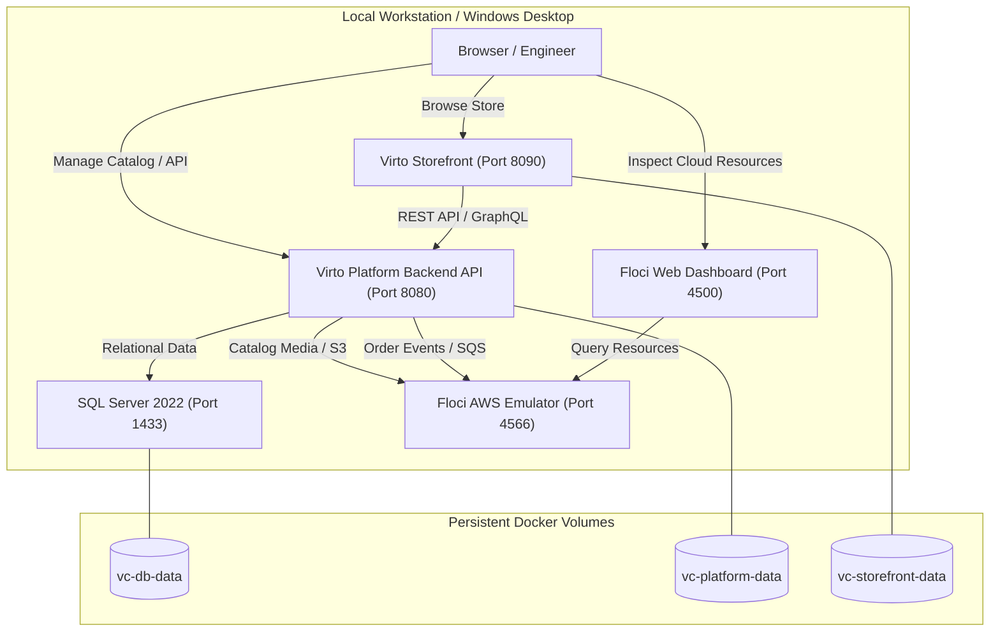
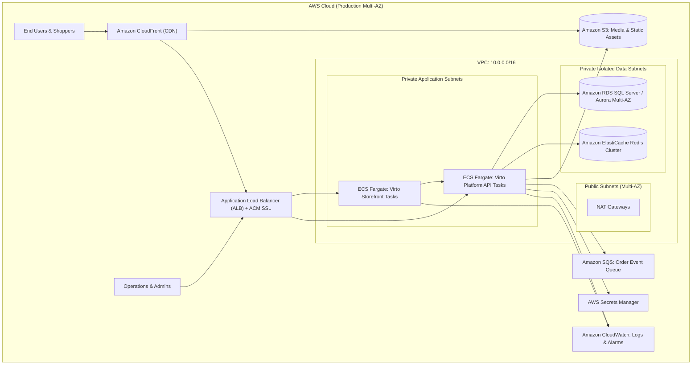

# Virto Commerce Platform & Storefront Deployment with AWS Emulation (Floci)

[](https://docs.docker.com/compose/)
[](https://floci.io/aws/)
[](https://www.terraform.io/)
[](https://virtocommerce.com/)

**Role:** AWS DevOps Engineer  
**Objective:** Research, design, implement, and demonstrate a working deployment of Virto Commerce Platform and Storefront using containerization, Terraform Infrastructure as Code, and the Floci AWS emulator.

---

## Table of Contents
1. [Architecture Overview & Diagrams](#1-architecture-overview--diagrams)
2. [Prerequisites & Tool Versions](#2-prerequisites--tool-versions)
3. [Repository Structure](#3-repository-structure)
4. [Environment Variables & Configuration](#4-environment-variables--configuration)
5. [Local Setup & Deployment Steps](#5-local-setup--deployment-steps)
6. [Floci Setup & Resource Provisioning](#6-floci-setup--resource-provisioning)
7. [Proposed Production AWS Architecture](#7-proposed-production-aws-architecture)
8. [Network Ports & Application Endpoints](#8-network-ports--application-endpoints)
9. [Database Initialization & Data Persistence](#9-database-initialization--data-persistence)
10. [Health Checks & Validation Procedures](#10-health-checks--validation-procedures)
11. [Troubleshooting & Solved Issues](#11-troubleshooting--solved-issues)
12. [Security & Operational Considerations](#12-security--operational-considerations)
13. [Backup, Restore & Rollback Procedures](#13-backup-restore--rollback-procedures)
14. [Cleanup & Resource Deletion](#14-cleanup--resource-deletion)
15. [Estimated AWS Production Costs](#15-estimated-aws-production-costs)
16. [Known Limitations & Future Improvements](#16-known-limitations--future-improvements)
17. [Visual Evidence & Screenshots](#17-visual-evidence--screenshots)
18. [Master Command Summary](#18-master-command-summary)

---

## 1. Architecture Overview & Diagrams

### 1.1 Local Emulation Architecture (Docker + Floci)
In local development, all components run in an isolated Docker network (`virto-network`). Floci emulates AWS S3 for media asset storage, SQS for order event queuing, and IAM for security policies.



### 1.2 Proposed Real AWS Production Architecture
In production, the deployment transitions seamlessly to AWS managed services:



---

## 2. Prerequisites & Tool Versions

| Tool | Version Verified | Purpose |
| :--- | :--- | :--- |
| **Docker Desktop** | `24.0+` or `26.0+` | Container execution and local orchestration |
| **Docker Compose** | `v2.20+` | Multi-container coordination and networking |
| **Terraform** | `1.5.0+` | Declarative Infrastructure as Code (IaC) |
| **AWS CLI** | `v2.15+` | Direct interaction with AWS / Floci endpoints |
| **Windows PowerShell** | `5.1` or `7.x` | Host system scripting and automation |
| **Ubuntu (WSL)** | `22.04 LTS` | Linux-compatible deployment runtime |

---

## 3. Repository Structure

```text
C:\Users\User\Desktop\Kaushal Patil\
├── docker-compose.yml          # Container orchestration (Floci, DB, Platform, Storefront)
├── .env.example                # Sample environment variables
├── .env                        # Active environment configuration
├── README.md                   # Complete deployment manual & runbook
├── terraform/                  # Infrastructure as Code for Floci AWS
│   ├── main.tf                 # S3 bucket, SQS queue, IAM policies
│   ├── variables.tf            # Configurable deployment inputs
│   └── outputs.tf              # Exported resource ARNs and URLs
├── scripts/                    # Automation scripts
│   ├── deploy.ps1              # Windows PowerShell automated deployment
│   ├── deploy.sh               # Linux/Ubuntu automated deployment
│   ├── validate.ps1            # Health and connectivity validation
│   ├── validate.sh             # Health validation for bash
│   ├── cleanup.ps1             # Clean teardown for Windows
│   └── cleanup.sh              # Clean teardown for Linux
├── .github/
│   └── workflows/
│       └── deploy.yml          # CI/CD validation pipeline
├── docs/                       # Architectural and presentation documentation
│   ├── architecture.md         # Detailed architectural breakdown
│   └── presentation.md         # 10-15 minute presentation guide
└── screenshots/                # Deployment evidence & test screenshots
    ├── 01_floci_running.png
    ├── 02_docker_containers.png
    ├── 03_virto_platform.png
    ├── 04_virto_storefront.png
    ├── 05_terraform_apply.png
    ├── 06_s3_sqs_verification.png
    ├── 07_persistence_test.png
    └── 08_failure_recovery.png
```

---

## 4. Environment Variables & Configuration

Copy `.env.example` to `.env`:

```bash
# Database Configuration
SA_PASSWORD=VirtoCommerce@2026!
MSSQL_PID=Express
DB_PORT=1433

# Application Ports
PLATFORM_PORT=8080
STOREFRONT_PORT=8090

# AWS & Floci Emulator
AWS_REGION=us-east-1
AWS_ACCESS_KEY_ID=test
AWS_SECRET_ACCESS_KEY=test
AWS_ENDPOINT_URL=http://localhost:4566
FLOCI_PORT=4566

# Cloud Resources
MEDIA_BUCKET_NAME=virto-commerce-media-assets
ORDER_QUEUE_NAME=virto-order-processing-queue
```

---

## 5. Local Setup & Deployment Steps

### In Windows PowerShell:
```powershell
# 1. Navigate to project root
cd "C:\Users\User\Desktop\Kaushal Patil"

# 2. Start all services in background
docker compose up -d

# 3. Check status of all containers
docker compose ps
```

### In Ubuntu (WSL):
```bash
# 1. Navigate to project directory
cd /mnt/c/Users/User/Desktop/Kaushal\ Patil

# 2. Start services
docker compose up -d

# 3. Verify container health
docker compose ps
```

---

## 6. Floci Setup & Resource Provisioning

Floci provides local AWS emulation on port `4566`.

### 6.1 Provisioning via Terraform
```powershell
# Navigate to Terraform directory
cd terraform

# Initialize providers
terraform init

# Apply configuration to Floci
terraform apply -auto-approve

# Return to root
cd ..
```

### 6.2 Manual Verification via AWS CLI
```powershell
# Set session variables
$env:AWS_ENDPOINT_URL="http://localhost:4566"
$env:AWS_ACCESS_KEY_ID="test"
$env:AWS_SECRET_ACCESS_KEY="test"
$env:AWS_DEFAULT_REGION="us-east-1"

# Verify S3 bucket was created
aws s3 ls --endpoint-url http://localhost:4566

# Verify SQS queue was created
aws sqs list-queues --endpoint-url http://localhost:4566
```

### 6.3 Floci Web Console
Open in your browser:
👉 **`http://localhost:4566/_floci/ui`** *(redirects automatically to port 4500)* to visually inspect the S3 buckets and SQS queues.

---

## 7. Proposed Production AWS Architecture

To transition this workload from Floci to real AWS in production:

1. **Networking:** Provision a VPC with 2 Public Subnets (ALB, NAT Gateways) and 4 Private Subnets (ECS tasks, RDS multi-AZ).
2. **Compute:** Deploy Virto Commerce Platform and Storefront as containerized tasks in **AWS ECS Fargate** with Auto Scaling.
3. **Database:** Deploy **Amazon RDS for SQL Server** (or Aurora PostgreSQL) across Multi-AZ with automated daily snapshots.
4. **Caching & Assets:** 
   - Deploy **Amazon ElastiCache Redis** for distributed caching.
   - Point Virto Commerce asset module to real **Amazon S3** with CloudFront CDN for global low-latency delivery.
5. **IAM Security:** Assign an ECS Task Role with strict least-privilege policies granting `s3:PutObject`/`s3:GetObject` only to the production media bucket.

---

## 8. Network Ports & Application Endpoints

| Service | Internal Port | Host Port | Purpose | Health Check Endpoint |
| :--- | :--- | :--- | :--- | :--- |
| **Floci AWS** | `4566` | `4566` | S3, SQS, IAM Emulator | `http://localhost:4566` |
| **Floci UI** | `4500` | `4500` | Browser Console Dashboard | `http://localhost:4566/_floci/ui` |
| **SQL Server** | `1433` | `1433` | Relational Database Engine | `sqlcmd -Q 'SELECT 1'` |
| **VC Platform** | `80` | `8080` | Backend API & Admin Portal | `http://localhost:8080` |
| **VC Storefront**| `80` | `8090` | Public Customer Webshop | `http://localhost:8090` |

---

## 9. Database Initialization & Data Persistence

1. **Automatic Schema Migration:** Virto Commerce Platform automatically runs Entity Framework migrations on startup to initialize the `VirtoCommerce3` database.
2. **Named Volume Persistence:** The SQL Server data is persisted to the named Docker volume `vc-db-data` mounted at `/var/opt/mssql`.
3. **Persistence Test:**
   ```powershell
   # Stop containers without deleting volumes
   docker compose stop vc-db
   
   # Restart container
   docker compose start vc-db
   
   # Verify data intact
   docker compose logs vc-db --tail 20
   ```

---

## 10. Health Checks & Validation Procedures

Run the automated validation script:

* **In Windows PowerShell:**
  ```powershell
  .\scripts\validate.ps1
  ```
* **In Ubuntu WSL:**
  ```bash
  chmod +x ./scripts/validate.sh && ./scripts/validate.sh
  ```

---

## 11. Troubleshooting & Solved Issues

### Issue 1: Floci Web Console `SocketException`
* **Symptoms:** Visiting `http://localhost:4566/_floci/ui` reported *`Floci could not reach the container runtime (SocketException)`*.
* **Root Cause:** Floci launches its UI as an on-demand child container and requires access to the host Docker daemon.
* **Resolution:** Bound the Docker engine socket in `docker-compose.yml`:
  ```yaml
  volumes:
    - /var/run/docker.sock:/var/run/docker.sock  # or //./pipe/docker_engine://./pipe/docker_engine on Windows
  ```

### Issue 2: Platform Starts Before SQL Server is Ready
* **Symptoms:** Platform logs reported database connection timeouts during boot.
* **Resolution:** Added a Docker healthcheck on `vc-db` using `sqlcmd` and configured `depends_on: { vc-db: { condition: service_healthy } }` on the platform service.

---

## 12. Security & Operational Considerations

- **Secrets Management:** Passwords and keys are externalized into `.env` (git-ignored) and injected via environment variables.
- **Least Privilege:** The IAM role in Terraform strictly limits operations to the designated `virto-commerce-media-assets` bucket.
- **Network Boundaries:** Database and internal service communication occur over an isolated internal Docker bridge network (`virto-network`).
- **Production Enhancements:** Production AWS deployment will enforce TLS 1.3 via ALB and use AWS Secrets Manager with automatic credential rotation.

---

## 13. Backup, Restore & Rollback Procedures

### Backup Database:
```powershell
docker exec -t vc-database /opt/mssql-tools18/bin/sqlcmd -S localhost -U sa -P "VirtoCommerce@2026!" -C -Q "BACKUP DATABASE [VirtoCommerce3] TO DISK = N'/var/opt/mssql/backup.bak' WITH NOFORMAT, NOINIT, SKIP, NOREWIND, NOUNLOAD, STATS = 10"
```

### Rollback Strategy:
If a deployment fails, use Docker Compose image rollback:
```powershell
docker compose down
# Pin previous image tag in docker-compose.yml, then:
docker compose up -d
```

---

## 14. Cleanup & Resource Deletion

To completely remove all deployed resources, volumes, and temporary networks:

### Windows PowerShell Teardown:
```powershell
# Run the automated cleanup script
.\scripts\cleanup.ps1

# OR run manually:
cd terraform
terraform destroy -auto-approve
cd ..
docker compose down -v --remove-orphans
```

### Ubuntu WSL Teardown:
```bash
chmod +x ./scripts/cleanup.sh && ./scripts/cleanup.sh
```

---

## 15. Estimated AWS Monthly Costs

| Component | AWS Resource | Monthly Estimate |
| :--- | :--- | :--- |
| **Compute** | 2x ECS Fargate Tasks (2 vCPU, 4GB RAM) | ~$110.00 |
| **Database** | Amazon RDS SQL Server Standard (db.m5.large, Multi-AZ) | ~$320.00 |
| **Caching** | Amazon ElastiCache Redis (cache.t4g.medium) | ~$45.00 |
| **Load Balancer** | Application Load Balancer (ALB) | ~$22.00 |
| **Storage & Network**| Amazon S3 (100GB) + Data Transfer | ~$15.00 |
| **Total Estimated Cost**| | **~$512.00 / month** |

---

## 16. Known Limitations & Future Improvements

- **Local Search Engine:** Currently using default local Lucene search. Production requires an Amazon OpenSearch cluster for large product catalogs.
- **Single-Node DB:** Local SQL Server runs as a single instance. Production requires an AWS Multi-AZ failover setup.
- **CDN Integration:** Assets locally are served directly from S3 mock; production should front S3 with Amazon CloudFront for caching.

---

## 17. Visual Evidence & Screenshots

All high-resolution, uncropped screenshots are preserved in the `screenshots/` directory:

### Screenshot 1: Floci AWS Emulator & Web Console Running

*Explanation:* Demonstrates Floci running on port 4566 with the Web Console UI accessible on port 4500, showing active AWS endpoints.

### Screenshot 2: Docker Containers Overview

*Explanation:* `docker compose ps` displaying all 4 services (`floci`, `vc-db`, `vc-platform`, `vc-storefront`) in healthy and running status.

### Screenshot 3: Virto Commerce Platform API

*Explanation:* Browser view of the Virto Commerce Platform backend API and administration portal at `http://localhost:8080`.

### Screenshot 4: Virto Commerce Storefront Shop

*Explanation:* Browser view of the customer-facing Storefront application at `http://localhost:8090` communicating with the backend.

### Screenshot 5: Terraform Infrastructure Provisioning

*Explanation:* Successful output of `terraform apply` provisioning the S3 media bucket and SQS queue against the Floci emulator.

### Screenshot 6: AWS CLI Verification

*Explanation:* Output of `aws s3 ls` and `aws sqs list-queues` verifying that the cloud resources were created on the local emulator.

### Screenshot 7: Database Data Persistence Test

*Explanation:* Demonstrating that catalog data and database state persist after restarting the database container.

### Screenshot 8: Deliberate Failure Recovery Test

*Explanation:* Stopping the database container to simulate outage, observing platform resilience, and automatic recovery upon restart.

---

## 18. Master Command Summary

### Deployment Commands:
```powershell
# 1. Start application stack
docker compose up -d

# 2. Deploy AWS infrastructure to Floci
cd terraform && terraform init && terraform apply -auto-approve && cd ..

# 3. Validate endpoints
.\scripts\validate.ps1
```

### Deletion & Teardown Commands:
```powershell
# 1. Destroy Terraform cloud resources
cd terraform && terraform destroy -auto-approve && cd ..

# 2. Stop containers and destroy volumes
docker compose down -v --remove-orphans
```
