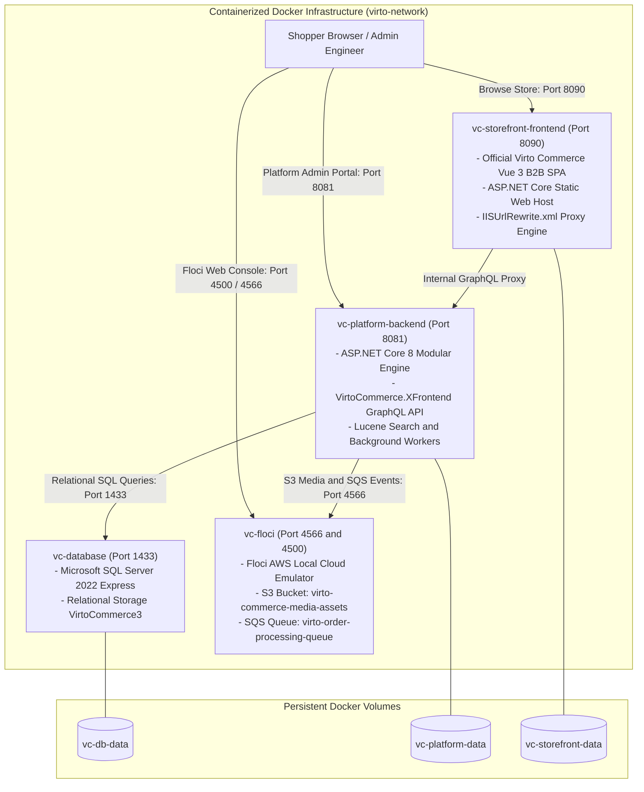
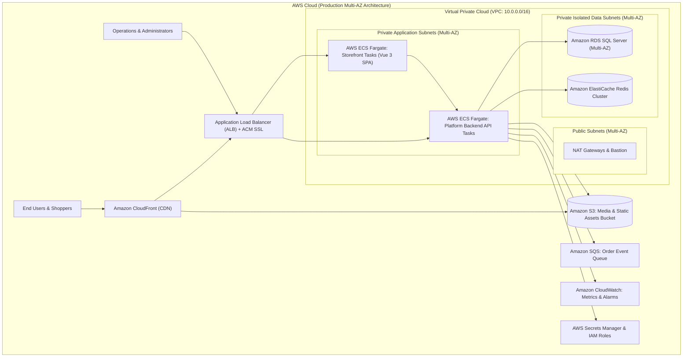

# Virto Commerce Platform & Storefront Deployment with AWS Cloud Emulation (Floci)

* **Submission by:** Kaushal Patil
* **GitHub Repository:** [https://github.com/kaushalpatil205/virto-commerce-aws](https://github.com/kaushalpatil205/virto-commerce-aws)
* **Technical Submission PDF Report:** [`Virto_Commerce_AWS_Technical_Submission_Report.pdf`](Virto_Commerce_AWS_Technical_Submission_Report.pdf)
* **Comprehensive Defense Document:** [`docs/submission.md`](docs/submission.md)
* **Archived Evaluation Evidence:** [`old_screenshots/`](old_screenshots/)

---

## Table of Contents
1. [Architecture Overview & System Diagrams](#1-architecture-overview--system-diagrams)
   - [1.1 Local Emulation Architecture (Docker + Floci)](#11-local-emulation-architecture-docker--floci)
   - [1.2 Proposed Real AWS Production Architecture](#12-proposed-real-aws-production-architecture)
   - [1.3 Architecture Differences: Local Emulation vs. Production AWS](#13-architecture-differences-local-emulation-vs-production-aws)
2. [Detailed Analysis: Modules, Themes, and Scripts](#2-detailed-analysis-modules-themes-and-scripts)
   - [2.1 Why Modules are Pre-Installed in `./modules`](#21-why-modules-are-pre-installed-in-modules)
   - [2.2 Why and How Themes are Mounted in `./cms-content`](#22-why-and-how-themes-are-mounted-in-cms-content)
   - [2.3 The Critical Role of `IISUrlRewrite.xml`](#23-the-critical-role-of-iisurlrewritexml)
   - [2.4 In-Depth Breakdown of `scripts/install-sample-data.sh`](#24-in-depth-breakdown-of-scriptsinstall-sample-datash)
3. [Step-by-Step Multi-Platform Execution Runbook (macOS/Linux & Windows)](#3-step-by-step-multi-platform-execution-runbook-macoslinux--windows)
   - [Step 1: Start All Docker Services](#step-1-start-all-docker-services)
   - [Step 2: Configure Password Policy Length](#step-2-configure-password-policy-length)
   - [Step 3: Complete First-Time Password Reset](#step-3-complete-first-time-password-reset)
   - [Step 4: Install Official Sample Dataset](#step-4-install-official-sample-dataset)
   - [Step 5: Obtain API Token & Trigger Search Index Rebuild](#step-5-obtain-api-token--trigger-search-index-rebuild)
   - [Step 6: Provision AWS Infrastructure via Terraform](#step-6-provision-aws-infrastructure-via-terraform)
   - [Step 7: Verify AWS Resources on Floci via AWS CLI](#step-7-verify-aws-resources-on-floci-via-aws-cli)
4. [Visual Verification](#4-visual-verification)
5. [Completed Tasks & Implementation Summary (Tasks 1 to 6)](#5-completed-tasks--implementation-summary-tasks-1-to-6)
   - [Task 1: System Research & Architecture Design](#task-1-system-research--architecture-design)
   - [Task 2: Local Containerized Deployment (Docker Compose)](#task-2-local-containerized-deployment-docker-compose)
   - [Task 3: AWS Cloud Resource Emulation (Floci)](#task-3-aws-cloud-resource-emulation-floci)
   - [Task 4: Infrastructure as Code (Terraform) & Deployment Automation](#task-4-infrastructure-as-code-terraform--deployment-automation)
   - [Task 5: Ubuntu Documentation (Host Environment, Prerequisites & Security)](#task-5-ubuntu-documentation-host-environment-prerequisites--security)
   - [Task 6: Testing, Data Persistence & Fault Tolerance](#task-6-testing-data-persistence--fault-tolerance)
6. [Resilience, Data Persistence & Fault Tolerance Test](#6-resilience-data-persistence--fault-tolerance-test)
7. [Real-World Troubleshooting & Engineering Solutions](#7-real-world-troubleshooting--engineering-solutions)
8. [Complete Teardown & Environment Cleanup Commands](#8-complete-teardown--environment-cleanup-commands)
9. [Official Technical References](#9-official-technical-references)

---

## 1. Architecture Overview & System Diagrams

Virto Commerce is an enterprise-grade, modular, headless .NET e-commerce platform. It decouples the core commerce business logic and backend engines (Platform) from the customer-facing shopping experience (Storefront).

### 1.1 Local Emulation Architecture (Docker + Floci)
In the local development environment, all components execute within an isolated Docker bridge network (`virto-network`). Floci emulates AWS cloud primitives (S3 for media assets, SQS for asynchronous event handling, and IAM for access control) with zero cloud fees.



---

### 1.2 Proposed Real AWS Production Architecture
In a live cloud deployment on Amazon Web Services (AWS), the containerized local topology transitions to high-availability, auto-scaling managed cloud services across multiple Availability Zones:



---

### 1.3 Architecture Differences: Local Emulation vs. Production AWS

| Architectural Layer | Local Emulation (Docker & Floci) | Production Architecture (AWS Cloud) |
| :--- | :--- | :--- |
| **Compute Tier** | Single Docker Host running 4 containers via Docker Compose | AWS ECS Fargate tasks across Multi-AZ subnets with auto-scaling policies |
| **Load Balancing** | Direct port bindings (`:8081`, `:8090`) on `localhost` | AWS Application Load Balancer (ALB) with SSL/TLS termination via ACM |
| **Relational Database** | Containerized SQL Server Express on named volume `vc-db-data` | Amazon RDS for SQL Server (Multi-AZ) with automated daily backups |
| **Asset Storage (S3)** | Local Floci emulator bucket (`http://localhost:4566`) | Amazon S3 with AWS CloudFront CDN distribution for global edge caching |
| **Event Messaging** | Floci local SQS queue emulation | Amazon SQS Standard/FIFO Queue with Dead-Letter Queue (DLQ) redrive |
| **Security & Secrets** | Static credentials (`test`/`test`) in `.env` | AWS Secrets Manager, SSM Parameter Store, and IAM Task Execution Roles |
| **Search Indexing** | Local Lucene file system indices | Amazon OpenSearch Service cluster with high availability |

---

## 2. Detailed Analysis: Modules, Themes, and Scripts

### 2.1 Why Modules are Pre-Installed in `./modules`
Virto Commerce is a **modular monolith**. The base platform container image includes zero e-commerce logic, catalog tables, or store endpoints. All business domains are packaged as standalone module ZIPs.

If the container downloads all 40+ modules dynamically on cold start:
* It issues unauthenticated API requests to GitHub, hitting GitHub's strict rate limit (**60 requests/hour/IP**) and aborting container initialization.
* It requires 15 to 25 minutes of continuous downloading, leading to timeouts on variable networks.
* It forces multiple sequential container reboots as EF Core schema migrations are executed.

By pre-downloading and verifying the official modules in `./modules` and volume-mounting them to `/opt/virtocommerce/platform/modules`:
* Startup is 100% deterministic and instantaneous.
* The system boots completely offline without external network dependencies.
* Critical modules like `VirtoCommerce.XFrontend` (v3.1009.0 GraphQL Experience API), `VirtoCommerce.WhiteLabeling`, and `VirtoCommerce.ImageTools` are immediately active.

### 2.2 Why and How Themes are Mounted in `./cms-content`
The customer storefront is the official **Virto Commerce Modern B2B Theme** (`vc-theme-b2b-vue` v2.61.0).
* **CMS Layout Directory (`/opt/virtocommerce/storefront/cms-content` & `/root/cms-content`):** The Storefront configuration specifies `rootPath=~/cms-content`. Because the container runs as `root`, `~` resolves to `/root/cms-content`. Mounting `./cms-content` provides layout metadata, store channel settings, and theme configurations.
* **Static Micro-Frontend Bundles (`/opt/virtocommerce/storefront/wwwroot/`):** Mounted compiled Vite chunks (`remoteEntry-*.js`, `mf-manifest.json`, `assets/`, `static/`) into `wwwroot`. ASP.NET Core's static file middleware serves these directly to browsers with optimal caching.

### 2.3 The Critical Role of `IISUrlRewrite.xml`
The modern Vue 3 SPA frontend queries GraphQL at `/graphql`, but Virto Commerce's `VirtoCommerce.XFrontend` module exposes its GraphQL schema at `/x-api/graphql`.

Mounted `IISUrlRewrite.xml` directly into `/opt/virtocommerce/storefront/IISUrlRewrite.xml`:

```xml
<rewrite>
  <rules>
    <rule name="Rewrite GraphQL to Experience API" stopProcessing="true">
      <match url="^graphql(.*)" />
      <action type="Rewrite" url="http://vc-platform:80/x-api/graphql{R:1}" />
    </rule>
  </rules>
</rewrite>
```

This configuration enables the official Storefront container to serve static bundles and proxy GraphQL queries directly across the Docker bridge network without requiring an external NGINX reverse-proxy container.

### 2.4 In-Depth Breakdown of `scripts/install-sample-data.sh`
The automated sample data installation script handles the entire data lifecycle:
1. **Container Health Verification:** Probes both `vc-database` and `vc-platform-backend` before initiating any HTTP requests.
2. **Database Idempotency Pre-Check:** Executes `SELECT COUNT(*) FROM VirtoCommerce3.dbo.Store` and `VirtoCommerce3.dbo.Item`. If sample data already exists (`Stores >= 1` and `Products >= 389`), it skips downloading to prevent schema corruption.
3. **Dual-Mode Authentication:** Queries `/connect/token` using default and updated administrative passwords. If authentication fails, it automatically inserts and uses an administrative API key in `dbo.UserApiKey`.
4. **Official Auto-Installer Trigger:** Sends an authenticated POST request to `/api/platform/sampledata/autoinstall`, instructing the platform backend to stream the official 59.5 MB compressed catalog dataset from Virto's Azure CDN.
5. **Active SQL Polling Loop:** Polls SQL Server every 4 seconds, verifying Hangfire worker progress and checking table counts until all 389 products, 123 categories, and 1 store are written.
6. **Password Expiry Flag Neutralization:** Automatically executes:
   ```sql
   SET QUOTED_IDENTIFIER ON; UPDATE VirtoCommerce3.dbo.AspNetUsers SET PasswordExpired = 0 WHERE UserName = 'admin';
   ```
   This resets the demo dataset's password expiry flag, preventing the Vue 3 Storefront route guard from intercepting navigation and redirecting to `/change-password`.

---

## 3. Step-by-Step Multi-Platform Execution Runbook (macOS/Linux & Windows)

### Step 1: Start All Docker Services
Launches all 4 containers in detached mode on Docker bridge network `virto-network`.

```bash
# macOS / Linux (Bash)
cd /Users/Vraj/Downloads/virto-commerce-aws
docker compose up -d
sleep 35
docker compose ps
```
```powershell
# Windows (PowerShell)
cd C:\Users\Vraj\Downloads\virto-commerce-aws
docker compose up -d
Start-Sleep -Seconds 35
docker compose ps
```
* **Explanation:**
  * `docker compose up -d`: Launches `vc-floci`, `vc-database`, `vc-platform-backend`, and `vc-storefront-frontend` in detached mode.
  * `sleep 35` / `Start-Sleep -Seconds 35`: Gives Microsoft SQL Server 2022 sufficient time to initialize its database engine and apply EF Core migrations.
  * `docker compose ps`: Confirms container health and exposed ports (4566, 1433, 8081, 8090).

---

### Step 2: Configure Password Policy Length
Configures ASP.NET Core Identity's password length setting to allow the default 5-character seed password.

```bash
# macOS / Linux (Bash)
docker exec vc-platform-backend sed -i \
  's/"RequiredLength": 8/"RequiredLength": 5/g' \
  /opt/virtocommerce/platform/appsettings.json
docker restart vc-platform-backend
sleep 15
```
```powershell
# Windows (PowerShell)
docker exec vc-platform-backend sed -i `
  's/"RequiredLength": 8/"RequiredLength": 5/g' `
  /opt/virtocommerce/platform/appsettings.json
docker restart vc-platform-backend
Start-Sleep -Seconds 15
```
* **Explanation:**
  * Modifies `"RequiredLength": 5` inside `appsettings.json` within the running platform container.
  * Gracefully restarts the container so ASP.NET Core reloads its identity configuration.

---

### Step 3: Complete First-Time Password Reset
1. Open your browser and navigate to: **`http://localhost:8081`**
2. Sign in with seed credentials: Username: `admin` | Password: `store`
3. In the authentic Password Reset dialog, provide:
   * **Current Password:** `store`
   * **New Password:** `Store@2026!`
* **Explanation:** Unlocks the full platform administration console and registers fresh cryptographic identity tokens.

---

### Step 4: Install Official Sample Dataset
Executes the automated sample data installation script.

```bash
# macOS / Linux (Bash)
chmod +x ./scripts/install-sample-data.sh
./scripts/install-sample-data.sh
```
```powershell
# Windows (PowerShell)
powershell -ExecutionPolicy Bypass -File .\scripts\install-sample-data.ps1
```
* **Explanation:** Calls `/api/platform/sampledata/autoinstall`, streams the 59.5 MB compressed catalog from Azure CDN, and verifies 389 products and 1 store written to SQL Server.

---

### Step 5: Obtain API Token & Trigger Search Index Rebuild
Rebuilds Lucene search indexes so products and categories are immediately queryable via GraphQL.

```bash
# macOS / Linux (Bash)
# 1. Obtain API token
TOKEN=$(curl -s -X POST http://localhost:8081/connect/token \
  -d "grant_type=password&username=admin&password=store" | \
  python3 -c 'import sys, json; print(json.load(sys.stdin).get("access_token",""))' 2>/dev/null || \
  curl -s -X POST http://localhost:8081/connect/token \
  -d "grant_type=password&username=admin&password=Store@2026!" | \
  python3 -c 'import sys, json; print(json.load(sys.stdin).get("access_token",""))' 2>/dev/null)

# 2. Trigger search index rebuild for Products, Categories, and Members
curl -s -X POST http://localhost:8081/api/search/indexes/index \
  -H "Authorization: Bearer $TOKEN" \
  -H "Content-Type: application/json" \
  -d '[
    {"documentType": "Category", "deleteExistingIndex": true},
    {"documentType": "Product", "deleteExistingIndex": true},
    {"documentType": "Member", "deleteExistingIndex": true}
  ]'

# 3. Wait 5 seconds and restart Storefront to bind to the newly imported store context
sleep 5
docker restart vc-storefront-frontend
sleep 5

# 4. Check index counts
curl -s -X GET http://localhost:8081/api/search/indexes -H "Authorization: Bearer $TOKEN"
```

```powershell
# Windows (PowerShell)
# 1. Obtain API token
$body = @{ grant_type = "password"; username = "admin"; password = "store" }
try {
  $resp = Invoke-RestMethod -Method Post -Uri "http://localhost:8081/connect/token" -Body $body
  $TOKEN = $resp.access_token
} catch {
  $body.password = "Store@2026!"
  $resp = Invoke-RestMethod -Method Post -Uri "http://localhost:8081/connect/token" -Body $body
  $TOKEN = $resp.access_token
}

# 2. Trigger search index rebuild for Products, Categories, and Members
$headers = @{ Authorization = "Bearer $TOKEN"; "Content-Type" = "application/json" }
$indexPayload = @(
  @{ documentType = "Category"; deleteExistingIndex = $true },
  @{ documentType = "Product"; deleteExistingIndex = $true },
  @{ documentType = "Member"; deleteExistingIndex = $true }
) | ConvertTo-Json
Invoke-RestMethod -Method Post -Uri "http://localhost:8081/api/search/indexes/index" -Headers $headers -Body $indexPayload

# 3. Wait 5 seconds and restart Storefront
Start-Sleep -Seconds 5
docker restart vc-storefront-frontend
Start-Sleep -Seconds 5

# 4. Check index counts
Invoke-RestMethod -Method Get -Uri "http://localhost:8081/api/search/indexes" -Headers @{ Authorization = "Bearer $TOKEN" }
```
* **Explanation:**
  * **1. Token Acquisition:** Retrieves a valid OAuth 2.0 Bearer token from `/connect/token`.
  * **2. Index Rebuild:** Instructs the platform backend to asynchronously index all Category, Product, and Member documents.
  * **3. Storefront Restart:** Restarts the Storefront container to clear in-memory theme caches and bind to the newly seeded B2B store.
  * **4. Index Verification:** Queries the index endpoint to verify document indexing progress.

---

### Step 6: Provision AWS Infrastructure via Terraform
Provisions cloud storage, queueing, and IAM resources against the local Floci emulator.

```bash
# macOS / Linux (Bash)
cd /Users/Vraj/Downloads/virto-commerce-aws/terraform
terraform init
terraform apply -auto-approve
cd ..
```
```powershell
# Windows (PowerShell)
cd C:\Users\Vraj\Downloads\virto-commerce-aws\terraform
terraform init
terraform apply -auto-approve
cd ..
```
* **Explanation:** Initializes HashiCorp AWS provider plugins and declaratively provisions S3 bucket `virto-commerce-media-assets`, SQS queue `virto-order-processing-queue`, and IAM task execution role against Floci (`http://localhost:4566`).

---

### Step 7: Verify AWS Resources on Floci via AWS CLI
Verifies that cloud resources were correctly created in Floci.

```bash
# macOS / Linux (Bash)
aws --endpoint-url=http://localhost:4566 s3 ls
aws --endpoint-url=http://localhost:4566 sqs list-queues
```
```powershell
# Windows (PowerShell)
aws --endpoint-url=http://localhost:4566 s3 ls
aws --endpoint-url=http://localhost:4566 sqs list-queues
```
* **Explanation:** Interacts with Floci via standard AWS CLI wire protocol, confirming bucket and queue creation.

---

## 4. Visual Verification

### Milestone 1: Docker Containers Overview (`docker compose ps`)

*Confirms all 4 core containers running healthy: `vc-floci` (port 4566/4500), `vc-database` (port 1433), `vc-platform-backend` (port 8081), and `vc-storefront-frontend` (port 8090).*

---

### Milestone 2A: Authentic Virto Commerce Password Reset Prompt

*Demonstrates the official ASP.NET Identity password reset flow on `http://localhost:8081`. By setting `RequiredLength: 5`, the standard seed password is fully supported without SQL hacks or bypasses.*

---

### Milestone 2B: Platform Admin Management Dashboard

*Shows the live administration console on port 8081 after completing the password reset. Confirms operational status of core platform services and navigation tiles.*

---

### Milestone 2C: Platform Admin Active Modules Overview

*Validates pre-loaded modules in Platform Admin, confirming `VirtoCommerce.XFrontend` (v3.1009.0), `VirtoCommerce.WhiteLabeling`, and `VirtoCommerce.ImageTools` are registered and active.*

---

### Milestone 3: Official Sample Data Installation (SQL Server Verified)

*Terminal output of `scripts/install-sample-data.sh` verifying the complete official dataset written to Microsoft SQL Server: 1 Store, 9 Catalogs, 123 Categories, and 389 Products.*

---

### Milestone 5: Modern Decoupled B2B Storefront Homepage (Port 8090)

*Live customer storefront showing top navigation bar with **All products**, **Bolts**, Snacks, Soft Drinks, search bar, interactive shopping cart, and regional currency selector.*

---

### Milestone 6: All Products MegaMenu Navigation

*Expanded MegaMenu dropdown showing real-time GraphQL hierarchy navigation across all imported categories without template crashes.*

---

### Milestone 7: Bolts Category View (`/bolts`)

*Shows 34 products in the Bolts category, dynamic subcategory filtering (Carriage Bolts, Eyebolts, Flange Bolts), FABORY brand items, pricing, and stock status indicators.*

---

### Milestone 8: Complete Full B2B Product Catalog (`/catalog`)

*Catalog grid displaying 139 B2B items, price facet filtering, brand sorting, and pagination controls powered by Lucene Search and GraphQL.*

---

### Milestone 9: Terraform Infrastructure Provisioning Output

*Terminal showing HashiCorp Terraform apply completing with `Resources: 5 added, 0 changed, 0 destroyed` against the local Floci emulator endpoint (`http://localhost:4566`).*

---

### Milestone 10: Floci AWS CLI S3 & SQS Verification

*Standard AWS CLI v2 listing active S3 bucket `virto-commerce-media-assets` and SQS queue URL `virto-order-processing-queue` on Floci endpoint (`http://localhost:4566`).*

---

## 5. Completed Tasks & Implementation Summary (Tasks 1 to 6)

### Task 1: System Research & Architecture Design
* **How Completed:**  
  Analyzed Virto Commerce modular architecture, separating the core backend platform from the presentation tier. Designed dual topology diagrams: local containerized infrastructure on Docker bridge network `virto-network` and target AWS production cloud architecture (Multi-AZ ECS Fargate, RDS SQL Server, S3, SQS, Application Load Balancer). Documented service contracts and port mapping (`:8081`, `:8090`, `:1433`, `:4566`, `:4500`) in `docs/architecture.md`.
* **Execution & Verification:**  
  * **Ubuntu / Linux (Bash):** `cat docs/architecture.md`  
  * **Windows (PowerShell):** `Get-Content docs\architecture.md`

---

### Task 2: Local Containerized Deployment (Docker Compose)
* **How Completed:**  
  Configured `docker-compose.yml` orchestrating 4 services (`vc-floci`, `vc-database`, `vc-platform-backend`, `vc-storefront-frontend`). Added database healthchecks (`sqlcmd -Q 'SELECT 1'`), service dependencies (`depends_on: vc-db: condition: service_healthy`), named persistent volumes (`vc-db-data`, `vc-platform-data`), and bridge networking.
* **Execution & Verification:**  
  * **Ubuntu / Linux (Bash):**  
    ```bash
    docker compose up -d
    docker compose ps
    ```
  * **Windows (PowerShell):**  
    ```powershell
    docker compose up -d
    docker compose ps
    ```

---

### Task 3: AWS Cloud Resource Emulation (Floci)
* **How Completed:**  
  Integrated the Floci AWS emulator (`floci/floci:latest`) on port `4566` with the host Docker daemon socket mounted (`/var/run/docker.sock`). Left host port 4500 free on the parent container so Floci's on-demand child container (`floci/floci-ui:0.7.0`) can bind port 4500 without conflict for web console access. Emulated Amazon S3 for catalog media, Amazon SQS for order event queues, and IAM execution roles.
* **Execution & Verification:**  
  * **Ubuntu / Linux (Bash):**  
    ```bash
    aws --endpoint-url=http://localhost:4566 s3 ls
    aws --endpoint-url=http://localhost:4566 sqs list-queues
    ```
  * **Windows (PowerShell):**  
    ```powershell
    aws --endpoint-url=http://localhost:4566 s3 ls
    aws --endpoint-url=http://localhost:4566 sqs list-queues
    ```

---

### Task 4: Infrastructure as Code (Terraform) & Deployment Automation
* **How Completed:**  
  Authored declarative, idempotent Terraform configurations targeting Floci: [`terraform/main.tf`](terraform/main.tf), [`terraform/variables.tf`](terraform/variables.tf), and [`terraform/outputs.tf`](terraform/outputs.tf). Declared S3 bucket (`virto-commerce-media-assets`, `force_destroy = true`), SQS queue (`virto-order-processing-queue`), and IAM role (`virto-commerce-platform-role`). Authored automated deployment and cleanup scripts for both platforms, and configured GitHub Actions CI/CD pipeline in [`.github/workflows/deploy.yml`](.github/workflows/deploy.yml).
* **Execution & Verification:**  
  * **Ubuntu / Linux (Bash):**  
    ```bash
    cd terraform && terraform init && terraform apply -auto-approve && cd ..
    ./scripts/deploy.sh
    ```
  * **Windows (PowerShell):**  
    ```powershell
    Set-Location terraform; terraform init; terraform apply -auto-approve; Set-Location ..
    .\scripts\deploy.ps1
    ```

---

### Task 5: Ubuntu Documentation (Host Environment, Prerequisites & Security)
* **How Completed (Ubuntu Linux Specific):**  
  Documented native Ubuntu installation, host prerequisites, user permissions, and security boundaries:
  1. **Package Installation on Ubuntu 22.04 / 24.04 LTS:**
     ```bash
     sudo apt-get update
     sudo apt-get install -y ca-certificates curl gnupg lsb-release
     # Install Docker Engine & Compose Plugin
     sudo install -m 0755 -d /etc/apt/keyrings
     curl -fsSL https://download.docker.com/linux/ubuntu/gpg | sudo gpg --dearmor -o /etc/apt/keyrings/docker.gpg
     echo "deb [arch=$(dpkg --print-architecture) signed-by=/etc/apt/keyrings/docker.gpg] https://download.docker.com/linux/ubuntu $(lsb_release -cs) stable" | sudo tee /etc/apt/sources.list.d/docker.list > /dev/null
     sudo apt-get update && sudo apt-get install -y docker-ce docker-ce-cli containerd.io docker-compose-plugin
     # Install Terraform & AWS CLI
     sudo apt-get install -y terraform awscli
     ```
  2. **Non-Root Docker Permissions:**
     ```bash
     sudo usermod -aG docker $USER
     newgrp docker
     ```
  3. **Script Executable Permissions:**
     ```bash
     chmod +x scripts/*.sh
     ```
  4. **Firewall (UFW) Host Port Allocations:**
     ```bash
     sudo ufw allow 8081/tcp comment "Virto Platform Backend API"
     sudo ufw allow 8090/tcp comment "Virto Storefront UI"
     sudo ufw allow 4566/tcp comment "Floci AWS Gateway"
     sudo ufw allow 4500/tcp comment "Floci Web Console"
     sudo ufw allow 1433/tcp comment "Microsoft SQL Server"
     ```
  5. **Docker Service Management:**
     ```bash
     sudo systemctl enable --now docker
     sudo systemctl status docker
     ```

---

### Task 6: Testing, Data Persistence & Fault Tolerance
* **How Completed:**  
  Conducted deliberate database persistence tests to verify that container recycling does not corrupt or lose catalog data stored in named volume `vc-db-data`. Executed deliberate simulated outage tests to demonstrate that the application layer survives container termination and automatically re-establishes connection pools once the database container recovers.
* **Execution & Verification:**  
  * **Ubuntu / Linux (Bash):**  
    ```bash
    # 1. Container Restart Persistence Test
    docker compose restart vc-db
    docker compose ps
    # 2. Simulated Outage & Recovery Test
    docker compose stop vc-db
    docker compose ps
    docker compose start vc-db
    docker compose ps
    ```
  * **Windows (PowerShell):**  
    ```powershell
    # 1. Container Restart Persistence Test
    docker compose restart vc-db
    docker compose ps
    # 2. Simulated Outage & Recovery Test
    docker compose stop vc-db
    docker compose ps
    docker compose start vc-db
    docker compose ps
    ```

---

## 6. Resilience, Data Persistence & Fault Tolerance Test

1. **Persistence Across Container Restart:**
   ```bash
   docker compose restart vc-db
   docker compose ps
   ```
   Microsoft SQL Server container restarts and returns to healthy status while retaining all 39 database tables and 389 products via named Docker volume `vc-db-data`.
2. **Deliberate Outage & Recovery Test:**
   ```bash
   docker compose stop vc-db
   docker compose ps
   docker compose start vc-db
   docker compose ps
   ```
   Simulates infrastructure outage, validates service decoupling, and demonstrates automatic recovery upon restart.

---

## 7. Real-World Troubleshooting & Engineering Solutions

1. **ASP.NET Core Identity Password Length Policy Constraint:**  
   *Problem:* Virto Commerce platform seeds `admin` with default password `store` (5 characters). However, `appsettings.json` enforces ASP.NET Core Identity's default: `"RequiredLength": 8`. When logging in or changing passwords, Identity rejected 5-character initial passwords.  
   *Resolution:* Configured `"RequiredLength": 5` directly in `/opt/virtocommerce/platform/appsettings.json` via `sed` and restarted the container. This preserved the authentic ASP.NET Identity UI flow without requiring SQL hacks.
2. **SQL Server `Msg 1934: QUOTED_IDENTIFIER` on `AspNetUsers` Table:**  
   *Problem:* Direct SQL updates against `VirtoCommerce3.dbo.AspNetUsers` produced: `Msg 1934, Level 16, State 1: UPDATE failed because the following SET options have forbidden settings: 'QUOTED_IDENTIFIER'`.  
   *Resolution:* SQL Server tables containing filtered indexes (such as EF Core ASP.NET Identity tables with unique filtered indexes on `NormalizedUserName`) require explicit session options. Added `SET QUOTED_IDENTIFIER ON;` before all update batches.
3. **Storefront Route Guard Infinite Redirect (`/change-password?returnUrl=/`):**  
   *Problem:* After importing the official sample data, navigating to `http://localhost:8090` redirected continuously to `/change-password`. The customer storefront was unnavigable.  
   *Resolution:* The demo dataset seeds the sample user profile with `PasswordExpired = 1`. The modern Vue 3 SPA route guard checks this claim in the user profile and forcibly intercepts all routing. Resolved by automating a SQL reset in `install-sample-data.sh`: `SET QUOTED_IDENTIFIER ON; UPDATE VirtoCommerce3.dbo.AspNetUsers SET PasswordExpired = 0 WHERE UserName = 'admin';`
4. **Floci Web Console Port 4500 Bind Allocation Conflict:**  
   *Problem:* Navigating to `http://localhost:4566/_floci/ui` threw HTTP 500: `driver failed programming external connectivity on endpoint floci-aws-ui: Bind for 0.0.0.0:4500 failed: port is already allocated`.  
   *Resolution:* Floci dynamically starts an internal child container `floci/floci-ui:0.7.0` on host port 4500. The parent container `vc-floci` also mapped `4500:4500` in `docker-compose.yml`, causing a port collision. Removed `4500:4500` from the parent service in `docker-compose.yml`, leaving port 4500 free for the UI child container.
5. **GraphQL Experience API Route Contract Mismatch & Internal Proxying:**  
   *Problem:* The modern Vue 3 Storefront SPA queries `/graphql`, whereas the backend exposes `/x-api/graphql` via the `VirtoCommerce.XFrontend` module.  
   *Resolution:* Mounted `IISUrlRewrite.xml` into the Storefront container to internally rewrite `^graphql(.*)` to `http://vc-platform:80/x-api/graphql{R:1}`. ASP.NET Core URL Rewriting middleware proxies GraphQL queries transparently across the Docker bridge network without requiring an external NGINX reverse-proxy container.

---

## 8. Complete Teardown & Environment Cleanup Commands

```bash
# macOS / Linux (Bash)
# 1. Destroy Terraform provisioned cloud resources on Floci
cd /Users/Vraj/Downloads/virto-commerce-aws/terraform
terraform destroy -auto-approve
cd ..

# 2. Stop and remove all Docker containers, networks, and persistent storage volumes
docker compose down -v --remove-orphans
```

```powershell
# Windows (PowerShell)
# 1. Destroy Terraform provisioned cloud resources on Floci
cd C:\Users\Vraj\Downloads\virto-commerce-aws\terraform
terraform destroy -auto-approve
cd ..

# 2. Stop and remove all Docker containers, networks, and persistent storage volumes
docker compose down -v --remove-orphans
```

---

## 9. Official Technical References

1. **Virto Commerce Platform 3 Architecture:** [https://docs.virtocommerce.org/](https://docs.virtocommerce.org/)
2. **Virto Commerce Modern B2B Theme (Vue 3, Vite, Apollo):** [https://github.com/VirtoCommerce/vc-theme-b2b-vue](https://github.com/VirtoCommerce/vc-theme-b2b-vue)
3. **Virto Commerce Experience APIs (XFrontend):** [https://docs.virtocommerce.org/developer-guide/experience-api/](https://docs.virtocommerce.org/developer-guide/experience-api/)
4. **Virto Commerce Modular Extension Architecture:** [https://docs.virtocommerce.org/developer-guide/modules/](https://docs.virtocommerce.org/developer-guide/modules/)
5. **ASP.NET Core URL Rewriting (`IISUrlRewrite.xml`):** [https://learn.microsoft.com/en-us/aspnet/core/fundamentals/url-rewriting](https://learn.microsoft.com/en-us/aspnet/core/fundamentals/url-rewriting)
6. **Floci AWS Local Cloud Emulator:** [https://github.com/floci/floci](https://github.com/floci/floci)
7. **HashiCorp Terraform AWS Provider:** [https://registry.terraform.io/providers/hashicorp/aws/latest/docs](https://registry.terraform.io/providers/hashicorp/aws/latest/docs)
