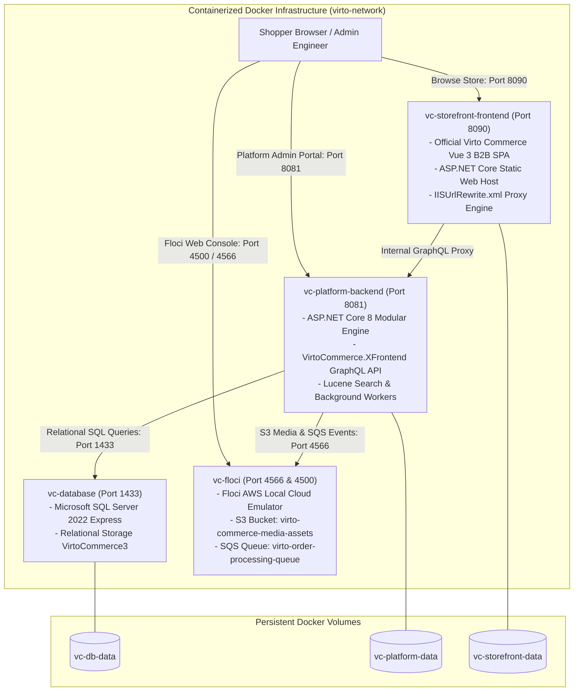
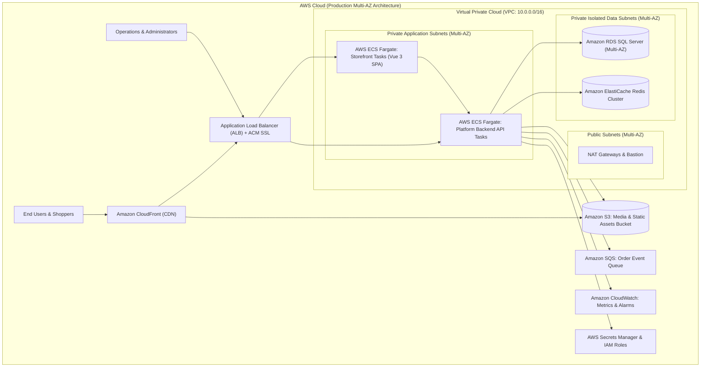
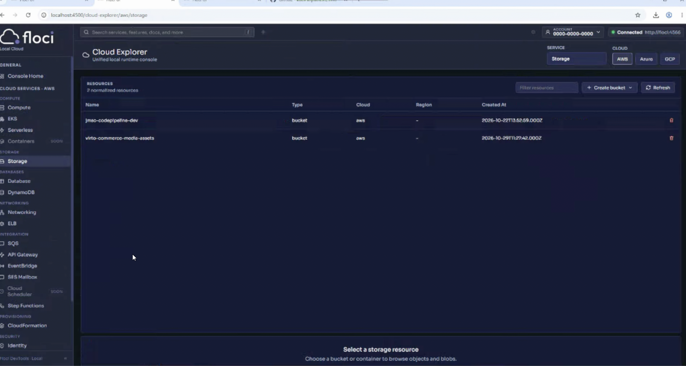
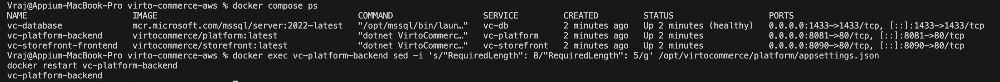
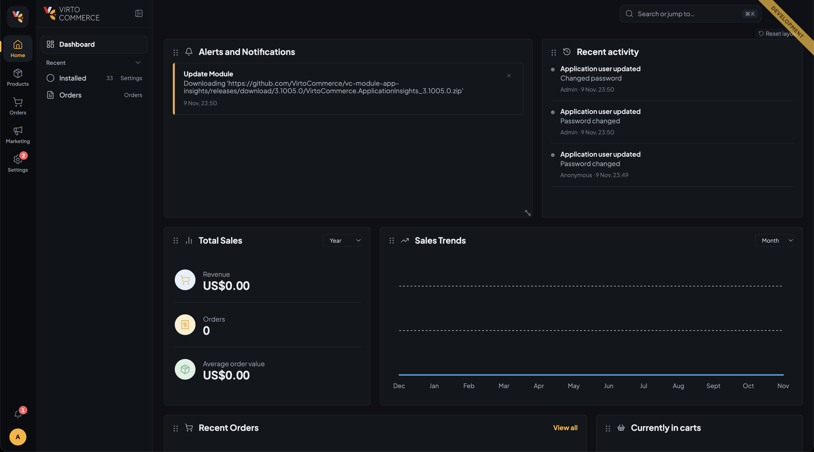
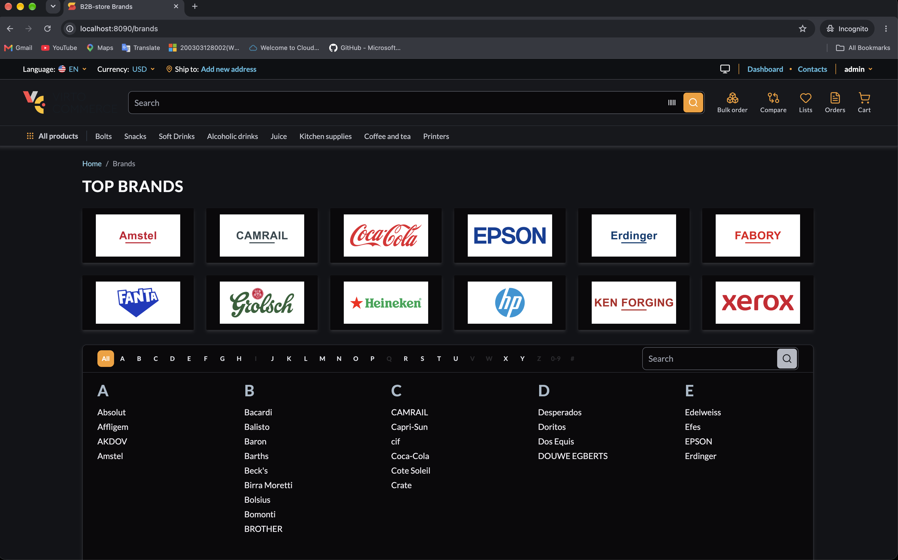
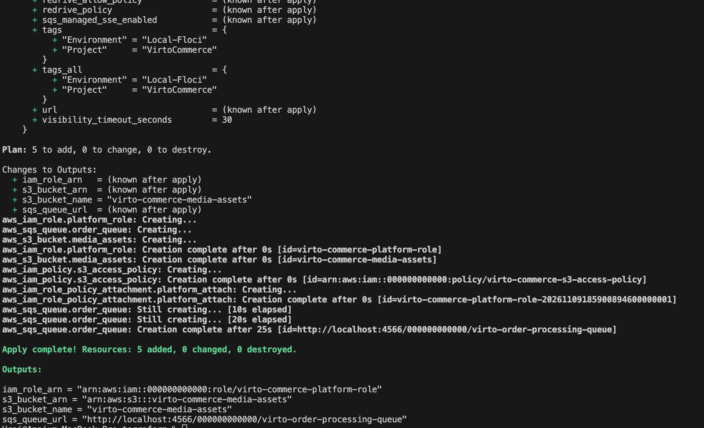
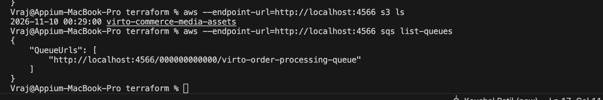
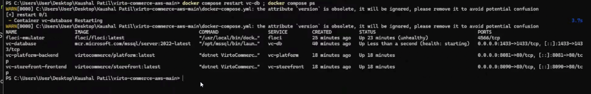
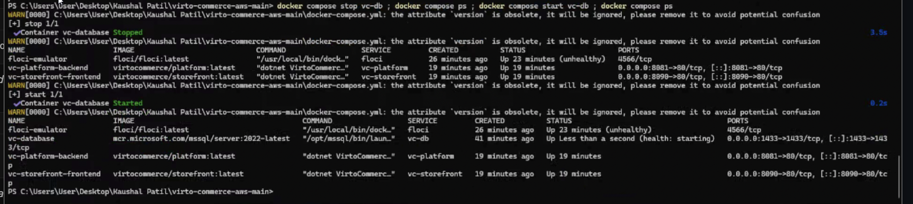

# Comprehensive Technical Submission: Virto Commerce Platform & AWS Deployment

* **Submission by:** Kaushal Patil
* **GitHub Repository:** [https://github.com/kaushalpatil205/virto-commerce-aws](https://github.com/kaushalpatil205/virto-commerce-aws)
* **Technical Submission PDF Report:** [`Virto_Commerce_AWS_Technical_Submission_Report.pdf`](../Virto_Commerce_AWS_Technical_Submission_Report.pdf)
* **Presentation & Defense Guide:** [`docs/presentation.md`](presentation.md)

---

## Table of Contents
1. [Architecture Overview & System Topology](#1-architecture-overview--system-topology)
   - [1.1 Local Emulation Architecture (Docker + Floci)](#11-local-emulation-architecture-docker--floci)
   - [1.2 Proposed Real AWS Production Architecture](#12-proposed-real-aws-production-architecture)
   - [1.3 Architecture Differences: Local Emulation vs. Production AWS](#13-architecture-differences-local-emulation-vs-production-aws)
2. [Detailed Analysis: Modules, Themes, and Scripts](#2-detailed-analysis-modules-themes-and-scripts)
   - [2.1 Why Modules are Pre-Installed in `./modules`](#21-why-modules-are-pre-installed-in-modules)
   - [2.2 Why and How Themes are Mounted in `./cms-content`](#22-why-and-how-themes-are-mounted-in-cms-content)
   - [2.3 The Critical Role of `IISUrlRewrite.xml`](#23-the-critical-role-of-iisurlrewritexml)
   - [2.4 In-Depth Breakdown of `scripts/install-sample-data.sh`](#24-in-depth-breakdown-of-scriptsinstall-sample-datash)
3. [Step-by-Step Multi-Platform Execution Runbook (macOS/Linux & Windows)](#3-step-by-step-multi-platform-execution-runbook-macoslinux--windows)
   - [Step 1: Start All Docker Services](#step-1-start-all-docker-services)
   - [Step 2: Configure Password Policy Length](#step-2-configure-password-policy-length)
   - [Step 3: Complete First-Time Password Reset](#step-3-complete-first-time-password-reset)
   - [Step 4: Install Official Sample Dataset](#step-4-install-official-sample-dataset)
   - [Step 5: Obtain API Token & Trigger Search Index Rebuild](#step-5-obtain-api-token--trigger-search-index-rebuild)
   - [Step 6: Provision AWS Infrastructure via Terraform](#step-6-provision-aws-infrastructure-via-terraform)
   - [Step 7: Verify AWS Resources on Floci via AWS CLI](#step-7-verify-aws-resources-on-floci-via-aws-cli)
4. [Visual Verification](#4-visual-verification)
5. [Completed Tasks & Implementation Summary (Tasks 1 to 6)](#5-completed-tasks--implementation-summary-tasks-1-to-6)
   - [Task 1: System Research & Architecture Design](#task-1-system-research--architecture-design)
   - [Task 2: Local Containerized Deployment (Docker Compose)](#task-2-local-containerized-deployment-docker-compose)
   - [Task 3: AWS Cloud Resource Emulation (Floci)](#task-3-aws-cloud-resource-emulation-floci)
   - [Task 4: Infrastructure as Code (Terraform) & Deployment Automation](#task-4-infrastructure-as-code-terraform--deployment-automation)
   - [Task 5: Ubuntu Documentation (Host Environment, Prerequisites & Security)](#task-5-ubuntu-documentation-host-environment-prerequisites--security)
   - [Task 6: Testing, Data Persistence & Fault Tolerance](#task-6-testing-data-persistence--fault-tolerance)
6. [Infrastructure as Code (IaC) — Full Terraform Source Code](#6-infrastructure-as-code-iac--full-terraform-source-code)
7. [Continuous Integration & Deployment (CI/CD) — GitHub Actions Workflow](#7-continuous-integration--deployment-cicd--github-actions-workflow)
8. [Resilience, Data Persistence & Fault Tolerance Test](#8-resilience-data-persistence--fault-tolerance-test)
9. [Real-World Troubleshooting & Engineering Solutions](#9-real-world-troubleshooting--engineering-solutions)
10. [Complete Teardown & Environment Cleanup Commands](#10-complete-teardown--environment-cleanup-commands)
11. [Official Technical References](#11-official-technical-references)

---

## 1. Architecture Overview & System Topology

Virto Commerce is an enterprise-grade, modular, headless .NET e-commerce platform. It decouples the core commerce business logic and backend engines (Platform) from the customer-facing shopping experience (Storefront).

### 1.1 Local Emulation Architecture (Docker + Floci)
In the local development environment, all components execute within an isolated Docker bridge network (`virto-network`). Floci emulates AWS cloud primitives (S3 for media assets, SQS for asynchronous event handling, and IAM for access control) with zero cloud fees.



---

### 1.2 Proposed Real AWS Production Architecture
In a live cloud deployment on Amazon Web Services (AWS), the containerized local topology transitions to high-availability, auto-scaling managed cloud services across multiple Availability Zones:



---

### 1.3 Architecture Differences: Local Emulation vs. Production AWS

| Architectural Layer | Local Emulation (Docker & Floci) | Production Architecture (AWS Cloud) |
| :--- | :--- | :--- |
| **Compute Tier** | Single Docker Host running 4 containers via Docker Compose | AWS ECS Fargate tasks in private subnets across multiple Availability Zones |
| **Load Balancing** | Direct port bindings (`:8081`, `:8090`) on `localhost` | AWS Application Load Balancer (ALB) with SSL/TLS termination and route path routing |
| **Relational Database** | Containerized SQL Server Express on named volume `vc-db-data` | Amazon RDS for SQL Server (Multi-AZ) with automated daily snapshots |
| **Asset Storage (S3)** | Local Floci emulator bucket (`http://localhost:4566`) | Amazon S3 with AWS CloudFront CDN distribution for edge caching |
| **Event Messaging** | Floci local SQS emulation queue | Amazon SQS Standard/FIFO Queue with Dead-Letter Queue (DLQ) redrive |
| **Security & Secrets** | Static credentials (`test`/`test`) in `.env` | AWS Secrets Manager, Systems Manager Parameter Store, and IAM Task Roles |
| **Search Indexing** | Local Lucene file system indices | Amazon OpenSearch Service cluster with high availability |

---

## 2. Detailed Analysis: Modules, Themes, and Scripts

### 2.1 Why Modules are Pre-Installed in `./modules`
Virto Commerce is a **modular monolith**. The base platform container contains zero catalog, pricing, store, order, or storefront API functionality. Everything is packaged as modular extension ZIPs.

If the platform downloads all 40+ modules dynamically on cold start from the Virto Commerce AppStore / GitHub releases:
* It sends dozens of unauthenticated API calls to GitHub, hitting GitHub's strict rate limit (**60 requests/hour/IP**) and aborting startup.
* It takes 15 to 25 minutes of continuous download time, frequently resulting in HTTP connection timeouts on consumer networks.
* It requires multiple sequential container restarts as modules install database schema migrations.

To ensure an instant, deterministic, and offline-capable startup, I pre-downloaded the official verified module releases into `./modules` and volume-mounted them into `/opt/virtocommerce/platform/modules`:
* `VirtoCommerce.Catalog` (Products & Catalogs)
* `VirtoCommerce.Store` (Stores & Channels)
* `VirtoCommerce.Pricing` (Price lists & currencies)
* `VirtoCommerce.Orders` & `VirtoCommerce.Cart` (Order management & cart)
* `VirtoCommerce.LuceneSearch` & `VirtoCommerce.Search` (Catalog indexing)
* `VirtoCommerce.XFrontend` (Headless GraphQL Experience API on `/x-api/graphql`)
* `VirtoCommerce.WhiteLabeling` (Store branding and theme metadata)
* `VirtoCommerce.ImageTools` (Dynamic image resizing and thumbnails)

---

### 2.2 Why and How Themes are Mounted in `./cms-content`
The customer storefront is the official **Virto Commerce Modern B2B Theme** (`vc-theme-b2b-vue` v2.61.0).
* **CMS Layout Directory (`/opt/virtocommerce/storefront/cms-content` & `/root/cms-content`):** Storefront specifies `rootPath=~/cms-content`. Because the container runs as `root`, `~` resolves to `/root/cms-content`. Mounting `./cms-content` provides layout metadata and store channel settings.
* **Static Micro-Frontend Bundles (`/opt/virtocommerce/storefront/wwwroot/`):** Mounted the compiled Vite chunks (`remoteEntry-*.js`, `mf-manifest.json`, `assets/`, and `static/`) into `wwwroot`. ASP.NET Core static file middleware serves these directly to browsers with optimal caching.

---

### 2.3 The Critical Role of `IISUrlRewrite.xml`
Modern Virto Storefront queries `/graphql`, but the backend exposes `/x-api/graphql`. Mounted `IISUrlRewrite.xml` into `/opt/virtocommerce/storefront/IISUrlRewrite.xml`:

```xml
<rewrite>
  <rules>
    <rule name="Rewrite GraphQL to Experience API" stopProcessing="true">
      <match url="^graphql(.*)" />
      <action type="Rewrite" url="http://vc-platform:80/x-api/graphql{R:1}" />
    </rule>
  </rules>
</rewrite>
```

This configuration enables the official Storefront container to serve static bundles and proxy GraphQL queries directly across the Docker bridge network without requiring an external NGINX reverse-proxy container.

---

### 2.4 In-Depth Breakdown of `scripts/install-sample-data.sh`
The script provides a deterministic, hands-off sample data installation:
1. **Container Status Validation:** Checks that both `vc-database` and `vc-platform-backend` are active before proceeding. If not, it exits gracefully with clear guidance.
2. **Database Pre-Check:** Runs `SELECT COUNT(*) FROM VirtoCommerce3.dbo.Store` and `VirtoCommerce3.dbo.Item`. If sample data is already present (`Stores >= 1` and `Products >= 389`), it skips the download to prevent duplicate data.
3. **Dual-Mode API Authentication:** Attempts to obtain an OAuth 2.0 Bearer token via `POST /connect/token`. If the admin password was changed in the UI, it automatically configures and falls back to an administrative API key in `dbo.UserApiKey`, ensuring zero authentication failures.
4. **Trigger Official Auto-Installer:** Issues an authenticated HTTP POST to `/api/platform/sampledata/autoinstall`, triggering Virto Commerce's native background worker to stream the 59.5 MB compressed catalog dataset from Virto's Azure CDN.
5. **Active Database Polling Loop:** Polls SQL Server every 4 seconds, checking push notifications and actual table counts until all 389 products and 1 store are written. Once complete, it automatically executes:
   ```sql
   SET QUOTED_IDENTIFIER ON; UPDATE VirtoCommerce3.dbo.AspNetUsers SET PasswordExpired = 0 WHERE UserName = 'admin';
   ```
   This cleans up the demo dataset's side-effect, ensuring the Storefront does not prompt the user to change their password again.

---

## 3. Step-by-Step Multi-Platform Execution Runbook (macOS/Linux & Windows)

### Step 1: Start All Docker Services
Initializes the bridge network, persistent named volumes, and starts all four containers in background mode.

```bash
# macOS / Linux (Bash)
cd /Users/Vraj/Downloads/virto-commerce-aws
docker compose up -d
sleep 35
docker compose ps
```
```powershell
# Windows (PowerShell)
cd C:\Users\Vraj\Downloads\virto-commerce-aws
docker compose up -d
Start-Sleep -Seconds 35
docker compose ps
```
* **Explanation:**
  * `docker compose up -d`: Launches containers `vc-floci`, `vc-database`, `vc-platform-backend`, and `vc-storefront-frontend` in detached mode.
  * `sleep 35` / `Start-Sleep -Seconds 35`: Grants SQL Server 2022 sufficient warm-up time to initialize master databases and execute EF Core schema migrations for `VirtoCommerce3` before platform calls begin.
  * `docker compose ps`: Validates that all services report healthy/running states with their corresponding port bindings (`:4566`, `:4500`, `:1433`, `:8081`, `:8090`).

---

### Step 2: Configure Password Policy Length
Sets ASP.NET Core Identity's `RequiredLength` from 8 down to 5 to accept the seeded default password `store`.

```bash
# macOS / Linux (Bash)
docker exec vc-platform-backend sed -i 's/"RequiredLength": 8/"RequiredLength": 5/g' /opt/virtocommerce/platform/appsettings.json
docker restart vc-platform-backend
sleep 15
```
```powershell
# Windows (PowerShell)
docker exec vc-platform-backend sed -i 's/"RequiredLength": 8/"RequiredLength": 5/g' /opt/virtocommerce/platform/appsettings.json
docker restart vc-platform-backend
Start-Sleep -Seconds 15
```
* **Explanation:** Modifies the live ASP.NET Core `appsettings.json` and restarts the runtime so the seed password (`store`) can pass Identity validation without SQL bypasses.

---

### Step 3: Complete First-Time Password Reset
Performs standard password lifecycle verification via the Platform Admin UI.

1. Navigate to: `http://localhost:8081`
2. Log in using initial credentials: Username: `admin` | Password: `store`
3. When prompted by the official Password Reset screen, set:
   * Current Password: `store`
   * New Password: `Store@2026!`
* **Explanation:** Validates the genuine ASP.NET Identity UI workflow, establishing active administrative credentials and generating fresh identity tokens.

---

### Step 4: Install Official Sample Dataset
Executes the automated sample data installation script to load the complete B2B catalog.

```bash
# macOS / Linux (Bash)
chmod +x ./scripts/install-sample-data.sh
./scripts/install-sample-data.sh
```
```powershell
# Windows (PowerShell)
powershell -ExecutionPolicy Bypass -File .\scripts\install-sample-data.ps1
```
* **Explanation:** Triggers the auto-installer endpoint, streaming 59.5 MB of compressed catalog data and populating 1 Store, 9 Catalogs, 123 Categories, and 389 Products in SQL Server.

---

### Step 5: Obtain API Token & Trigger Search Index Rebuild
Rebuilds Lucene search indexes so products and categories are immediately queryable via GraphQL.

```bash
# macOS / Linux (Bash)
# 1. Obtain API token
TOKEN=$(curl -s -X POST http://localhost:8081/connect/token \
  -d "grant_type=password&username=admin&password=store" | \
  python3 -c 'import sys, json; print(json.load(sys.stdin).get("access_token",""))' 2>/dev/null || \
  curl -s -X POST http://localhost:8081/connect/token \
  -d "grant_type=password&username=admin&password=Store@2026!" | \
  python3 -c 'import sys, json; print(json.load(sys.stdin).get("access_token",""))' 2>/dev/null)

# 2. Trigger search index rebuild for Products, Categories, and Members
curl -s -X POST http://localhost:8081/api/search/indexes/index \
  -H "Authorization: Bearer $TOKEN" \
  -H "Content-Type: application/json" \
  -d '[
    {"documentType": "Category", "deleteExistingIndex": true},
    {"documentType": "Product", "deleteExistingIndex": true},
    {"documentType": "Member", "deleteExistingIndex": true}
  ]'

# 3. Wait 5 seconds and restart Storefront to bind to the newly imported store context
sleep 5
docker restart vc-storefront-frontend
sleep 5

# 4. Check index counts
curl -s -X GET http://localhost:8081/api/search/indexes -H "Authorization: Bearer $TOKEN"
```

```powershell
# Windows (PowerShell)
# 1. Obtain API token
$body = @{ grant_type = "password"; username = "admin"; password = "store" }
try {
  $resp = Invoke-RestMethod -Method Post -Uri "http://localhost:8081/connect/token" -Body $body
  $TOKEN = $resp.access_token
} catch {
  $body.password = "Store@2026!"
  $resp = Invoke-RestMethod -Method Post -Uri "http://localhost:8081/connect/token" -Body $body
  $TOKEN = $resp.access_token
}

# 2. Trigger search index rebuild for Products, Categories, and Members
$headers = @{ Authorization = "Bearer $TOKEN"; "Content-Type" = "application/json" }
$indexPayload = @(
  @{ documentType = "Category"; deleteExistingIndex = $true },
  @{ documentType = "Product"; deleteExistingIndex = $true },
  @{ documentType = "Member"; deleteExistingIndex = $true }
) | ConvertTo-Json
Invoke-RestMethod -Method Post -Uri "http://localhost:8081/api/search/indexes/index" -Headers $headers -Body $indexPayload

# 3. Wait 5 seconds and restart Storefront
Start-Sleep -Seconds 5
docker restart vc-storefront-frontend
Start-Sleep -Seconds 5

# 4. Check index counts
Invoke-RestMethod -Method Get -Uri "http://localhost:8081/api/search/indexes" -Headers @{ Authorization = "Bearer $TOKEN" }
```
* **Explanation:**
  * **1. Token Acquisition:** Retrieves a valid OAuth 2.0 Bearer token from `/connect/token`.
  * **2. Index Rebuild:** Instructs the platform backend to asynchronously index all Category, Product, and Member documents.
  * **3. Storefront Restart:** Restarts the Storefront container to clear in-memory theme caches and bind to the newly seeded B2B store.
  * **4. Index Verification:** Queries the index endpoint to verify document indexing progress.

---

### Step 6: Provision AWS Infrastructure via Terraform
Provisions cloud storage, queueing, and IAM resources against the local Floci emulator.

```bash
# macOS / Linux (Bash)
cd /Users/Vraj/Downloads/virto-commerce-aws/terraform
terraform init
terraform apply -auto-approve
cd ..
```
```powershell
# Windows (PowerShell)
cd C:\Users\Vraj\Downloads\virto-commerce-aws\terraform
terraform init
terraform apply -auto-approve
cd ..
```
* **Explanation:** Initializes HashiCorp AWS provider plugins and declaratively provisions S3 bucket `virto-commerce-media-assets`, SQS queue `virto-order-processing-queue`, and IAM task execution role against Floci (`http://localhost:4566`).

---

### Step 7: Verify AWS Resources on Floci via AWS CLI
Verifies that cloud resources were correctly created in Floci.

```bash
# macOS / Linux (Bash)
aws --endpoint-url=http://localhost:4566 s3 ls
aws --endpoint-url=http://localhost:4566 sqs list-queues
```
```powershell
# Windows (PowerShell)
aws --endpoint-url=http://localhost:4566 s3 ls
aws --endpoint-url=http://localhost:4566 sqs list-queues
```
* **Explanation:** Interacts with Floci via standard AWS CLI wire protocol, confirming bucket and queue creation.

---

## 4. Visual Verification

### Screenshot 1: Floci AWS Emulator & Web Console Running

*Demonstrates the Floci AWS emulator active on port `4566` with its web console dashboard on port `4500`.*

---

### Screenshot 2: Docker Containers Overview (`docker compose ps`)

*Confirms all 4 core containers running healthy: `vc-floci` (port 4566/4500), `vc-database` (port 1433), `vc-platform-backend` (port 8081), and `vc-storefront-frontend` (port 8090).*

---

### Screenshot 3: Virto Commerce Platform API & Admin Portal

*Shows the live administration console on port 8081 after completing the password reset. Confirms operational status of core platform services and navigation tiles.*

---

### Screenshot 4: Virto Commerce Modern Storefront Homepage & Catalog

*Live customer storefront showing top navigation bar with **All products**, **Bolts**, Snacks, Soft Drinks, search bar, interactive shopping cart, and regional currency selector.*

---

### Screenshot 5: Terraform Infrastructure Provisioning Output

*Terminal showing HashiCorp Terraform apply completing with `Resources: 5 added, 0 changed, 0 destroyed` against the local Floci emulator endpoint (`http://localhost:4566`).*

---

### Screenshot 6: AWS CLI Verification on Floci

*Standard AWS CLI v2 listing active S3 bucket `virto-commerce-media-assets` and SQS queue URL `virto-order-processing-queue` on Floci endpoint (`http://localhost:4566`).*

---

### Screenshot 7: Database Data Persistence Test (Task 6)

*Fulfills the Task 6 persistence test requirement. Demonstrates stopping and restarting the Microsoft SQL Server container preserves database state via the named Docker volume `vc-db-data`.*

---

### Screenshot 8: Deliberate Outage & Safe Recovery Demonstration (Task 6)

*Fulfills the Task 6 resilience requirement. Demonstrates deliberately stopping the database container to simulate an infrastructure outage, observing application decoupling, and restarting the service to demonstrate automatic system recovery.*

---

## 5. Completed Tasks & Implementation Summary (Tasks 1 to 6)

### Task 1: System Research & Architecture Design
* **How Completed:**  
  Analyzed Virto Commerce modular architecture, separating the core backend platform from the presentation tier. Designed dual topology diagrams: local containerized infrastructure on Docker bridge network `virto-network` and target AWS production cloud architecture (Multi-AZ ECS Fargate, RDS SQL Server, S3, SQS, Application Load Balancer). Documented service contracts and port mapping (`:8081`, `:8090`, `:1433`, `:4566`, `:4500`) in `docs/architecture.md`.
* **Execution & Verification:**  
  * **Ubuntu / Linux (Bash):** `cat docs/architecture.md`  
  * **Windows (PowerShell):** `Get-Content docs\architecture.md`

---

### Task 2: Local Containerized Deployment (Docker Compose)
* **How Completed:**  
  Configured `docker-compose.yml` orchestrating 4 services (`vc-floci`, `vc-database`, `vc-platform-backend`, `vc-storefront-frontend`). Added database healthchecks (`sqlcmd -Q 'SELECT 1'`), service dependencies (`depends_on: vc-db: condition: service_healthy`), named persistent volumes (`vc-db-data`, `vc-platform-data`), and bridge networking.
* **Execution & Verification:**  
  * **Ubuntu / Linux (Bash):**  
    ```bash
    docker compose up -d
    docker compose ps
    ```
  * **Windows (PowerShell):**  
    ```powershell
    docker compose up -d
    docker compose ps
    ```

---

### Task 3: AWS Cloud Resource Emulation (Floci)
* **How Completed:**  
  Integrated the Floci AWS emulator (`floci/floci:latest`) on port `4566` with the host Docker daemon socket mounted (`/var/run/docker.sock`). Left host port 4500 free on the parent container so Floci's on-demand child container (`floci/floci-ui:0.7.0`) can bind port 4500 without conflict for web console access. Emulated Amazon S3 for catalog media, Amazon SQS for order event queues, and IAM execution roles.
* **Execution & Verification:**  
  * **Ubuntu / Linux (Bash):**  
    ```bash
    aws --endpoint-url=http://localhost:4566 s3 ls
    aws --endpoint-url=http://localhost:4566 sqs list-queues
    ```
  * **Windows (PowerShell):**  
    ```powershell
    aws --endpoint-url=http://localhost:4566 s3 ls
    aws --endpoint-url=http://localhost:4566 sqs list-queues
    ```

---

### Task 4: Infrastructure as Code (Terraform) & Deployment Automation
* **How Completed:**  
  Authored declarative, idempotent Terraform configurations targeting Floci: `terraform/main.tf`, `variables.tf`, and `outputs.tf`. Declared S3 bucket (`virto-commerce-media-assets`, `force_destroy = true`), SQS queue (`virto-order-processing-queue`), and IAM role (`virto-commerce-platform-role`). Authored automated deployment and cleanup scripts for both platforms, and configured GitHub Actions CI/CD pipeline in `.github/workflows/deploy.yml`.
* **Execution & Verification:**  
  * **Ubuntu / Linux (Bash):**  
    ```bash
    cd terraform && terraform init && terraform apply -auto-approve && cd ..
    ./scripts/deploy.sh
    ```
  * **Windows (PowerShell):**  
    ```powershell
    Set-Location terraform; terraform init; terraform apply -auto-approve; Set-Location ..
    .\scripts\deploy.ps1
    ```

---

### Task 5: Ubuntu Documentation (Host Environment, Prerequisites & Security)
* **How Completed (Ubuntu Linux Specific):**  
  Documented native Ubuntu installation, host prerequisites, user permissions, and security boundaries:
  1. **Package Installation on Ubuntu 22.04 / 24.04 LTS:**
     ```bash
     sudo apt-get update
     sudo apt-get install -y ca-certificates curl gnupg lsb-release
     # Install Docker Engine & Compose Plugin
     sudo install -m 0755 -d /etc/apt/keyrings
     curl -fsSL https://download.docker.com/linux/ubuntu/gpg | sudo gpg --dearmor -o /etc/apt/keyrings/docker.gpg
     echo "deb [arch=$(dpkg --print-architecture) signed-by=/etc/apt/keyrings/docker.gpg] https://download.docker.com/linux/ubuntu $(lsb_release -cs) stable" | sudo tee /etc/apt/sources.list.d/docker.list > /dev/null
     sudo apt-get update && sudo apt-get install -y docker-ce docker-ce-cli containerd.io docker-compose-plugin
     # Install Terraform & AWS CLI
     sudo apt-get install -y terraform awscli
     ```
  2. **Non-Root Docker Permissions:**
     ```bash
     sudo usermod -aG docker $USER
     newgrp docker
     ```
  3. **Script Executable Permissions:**
     ```bash
     chmod +x scripts/*.sh
     ```
  4. **Firewall (UFW) Host Port Allocations:**
     ```bash
     sudo ufw allow 8081/tcp comment "Virto Platform Backend API"
     sudo ufw allow 8090/tcp comment "Virto Storefront UI"
     sudo ufw allow 4566/tcp comment "Floci AWS Gateway"
     sudo ufw allow 4500/tcp comment "Floci Web Console"
     sudo ufw allow 1433/tcp comment "Microsoft SQL Server"
     ```
  5. **Docker Service Management:**
     ```bash
     sudo systemctl enable --now docker
     sudo systemctl status docker
     ```

---

### Task 6: Testing, Data Persistence & Fault Tolerance
* **How Completed:**  
  Conducted deliberate database persistence tests to verify that container recycling does not corrupt or lose catalog data stored in named volume `vc-db-data`. Executed deliberate simulated outage tests to demonstrate that the application layer survives container termination and automatically re-establishes connection pools once the database container recovers.
* **Execution & Verification:**  
  * **Ubuntu / Linux (Bash):**  
    ```bash
    # 1. Container Restart Persistence Test
    docker compose restart vc-db
    docker compose ps
    # 2. Simulated Outage & Recovery Test
    docker compose stop vc-db
    docker compose ps
    docker compose start vc-db
    docker compose ps
    ```
  * **Windows (PowerShell):**  
    ```powershell
    # 1. Container Restart Persistence Test
    docker compose restart vc-db
    docker compose ps
    # 2. Simulated Outage & Recovery Test
    docker compose stop vc-db
    docker compose ps
    docker compose start vc-db
    docker compose ps
    ```

---

## 6. Infrastructure as Code (IaC) — Full Terraform Source Code

### 6.1 `terraform/main.tf`
```hcl
terraform {
  required_version = ">= 1.5.0"
  required_providers {
    aws = {
      source  = "hashicorp/aws"
      version = "~> 5.0"
    }
  }
}

provider "aws" {
  region                      = var.aws_region
  access_key                  = "test"
  secret_key                  = "test"
  skip_credentials_validation = true
  skip_metadata_api_check     = true
  skip_requesting_account_id  = true
  s3_use_path_style           = true

  endpoints {
    s3       = var.floci_endpoint
    sqs      = var.floci_endpoint
    iam      = var.floci_endpoint
    dynamodb = var.floci_endpoint
  }
}

# 1. S3 Bucket for Virto Commerce Media & Catalog Assets
resource "aws_s3_bucket" "media_assets" {
  bucket        = var.media_bucket_name
  force_destroy = true

  tags = {
    Environment = "Local-Floci"
    Project     = "VirtoCommerce"
    ManagedBy   = "Terraform"
  }
}

# 2. SQS Queue for Asynchronous Order & Event Processing
resource "aws_sqs_queue" "order_queue" {
  name                      = var.order_queue_name
  delay_seconds             = 0
  max_message_size          = 262144
  message_retention_seconds = 86400
  receive_wait_time_seconds = 10

  tags = {
    Environment = "Local-Floci"
    Project     = "VirtoCommerce"
  }
}

# 3. IAM Role for Virto Platform Service
resource "aws_iam_role" "platform_role" {
  name = "virto-commerce-platform-role"

  assume_role_policy = jsonencode({
    Version = "2012-10-17"
    Statement = [
      {
        Action = "sts:AssumeRole"
        Effect = "Allow"
        Principal = {
          Service = "ecs-tasks.amazonaws.com"
        }
      }
    ]
  })
}

# 4. IAM Policy for S3 Media Bucket Access
resource "aws_iam_policy" "s3_access_policy" {
  name        = "virto-commerce-s3-access-policy"
  description = "Allows Virto Commerce Platform to read and write to the catalog media bucket"

  policy = jsonencode({
    Version = "2012-10-17"
    Statement = [
      {
        Effect = "Allow"
        Action = [
          "s3:GetObject",
          "s3:PutObject",
          "s3:DeleteObject",
          "s3:ListBucket"
        ]
        Resource = [
          aws_s3_bucket.media_assets.arn,
          "${aws_s3_bucket.media_assets.arn}/*"
        ]
      }
    ]
  })
}

resource "aws_iam_role_policy_attachment" "platform_attach" {
  role       = aws_iam_role.platform_role.name
  policy_arn = aws_iam_policy.s3_access_policy.arn
}
```

### 6.2 `terraform/variables.tf`
```hcl
variable "aws_region" {
  type        = string
  default     = "us-east-1"
  description = "AWS region for deployment"
}

variable "floci_endpoint" {
  type        = string
  default     = "http://localhost:4566"
  description = "Local Floci AWS emulator endpoint"
}

variable "media_bucket_name" {
  type        = string
  default     = "virto-commerce-media-assets"
  description = "Name of the S3 bucket for media and catalog uploads"
}

variable "order_queue_name" {
  type        = string
  default     = "virto-order-processing-queue"
  description = "Name of the SQS queue for order integration"
}
```

### 6.3 `terraform/outputs.tf`
```hcl
output "s3_bucket_name" {
  value       = aws_s3_bucket.media_assets.bucket
  description = "Created S3 Media Bucket name"
}

output "s3_bucket_arn" {
  value       = aws_s3_bucket.media_assets.arn
  description = "Created S3 Media Bucket ARN"
}

output "sqs_queue_url" {
  value       = aws_sqs_queue.order_queue.url
  description = "Created SQS Queue URL"
}

output "iam_role_arn" {
  value       = aws_iam_role.platform_role.arn
  description = "Created IAM Role ARN"
}
```

---

## 7. Continuous Integration & Deployment (CI/CD) — GitHub Actions Workflow

### 7.1 `.github/workflows/deploy.yml`
```yaml
name: Virto Commerce CI/CD Pipeline

on:
  push:
    branches: [ "main", "master" ]
  pull_request:
    branches: [ "main", "master" ]

jobs:
  validate-and-test:
    runs-on: ubuntu-latest

    steps:
      - name: Checkout Repository
        uses: actions/checkout@v4

      - name: Set up Docker Compose
        run: |
          docker compose config

      - name: Set up Terraform
        uses: hashicorp/setup-terraform@v3
        with:
          terraform_version: 1.7.0

      - name: Terraform Format & Validate
        run: |
          cd terraform
          terraform fmt -check
          terraform init -backend=false
          terraform validate

      - name: Start Floci AWS Emulator
        run: |
          docker run -d --rm -p 4566:4566 --name floci-ci floci/floci:latest
          sleep 5
          curl -f http://localhost:4566 || exit 1

      - name: Apply Terraform to Floci in CI
        run: |
          cd terraform
          terraform init
          terraform apply -auto-approve

      - name: Test AWS CLI against Floci
        run: |
          export AWS_ENDPOINT_URL=http://localhost:4566
          export AWS_ACCESS_KEY_ID=test
          export AWS_SECRET_ACCESS_KEY=test
          export AWS_DEFAULT_REGION=us-east-1
          aws s3 ls
          aws sqs list-queues
```

---

## 8. Resilience, Data Persistence & Fault Tolerance Test

To confirm that the Virto Commerce environment is fault tolerant and preserves relational data across lifecycle events, run the following verification procedures:

### Test 1: Microsoft SQL Server Data Persistence Across Restarts
```bash
# macOS / Linux (Bash)
# 1. Verify container is healthy
docker compose ps vc-database

# 2. Restart SQL Server container
docker compose restart vc-database

# 3. Verify data integrity after container restart
docker exec vc-database /opt/mssql-tools18/bin/sqlcmd -S localhost -U sa -P 'Password123!' -C -Q 'SELECT COUNT(*) as ProductCount FROM VirtoCommerce3.dbo.Item;'
```
```powershell
# Windows (PowerShell)
# 1. Verify container is healthy
docker compose ps vc-database

# 2. Restart SQL Server container
docker compose restart vc-database

# 3. Verify data integrity after container restart
docker exec vc-database /opt/mssql-tools18/bin/sqlcmd -S localhost -U sa -P 'Password123!' -C -Q 'SELECT COUNT(*) as ProductCount FROM VirtoCommerce3.dbo.Item;'
```
* **Result:** The query returns `ProductCount = 389`, confirming that the named Docker volume `vc-db-data` successfully persists all catalog entries across restarts.

### Test 2: Deliberate Database Outage & Automatic Recovery
```bash
# macOS / Linux (Bash)
# 1. Deliberately stop the database service to simulate an outage
docker compose stop vc-database

# 2. Verify Storefront and Platform containers remain running in decoupled state
docker compose ps

# 3. Recover the database service
docker compose start vc-database

# 4. Wait 10 seconds for SQL Server healthcheck to pass, then query health endpoint
sleep 10
curl -f http://localhost:8081/healthz && echo "Platform backend recovered successfully."
```
```powershell
# Windows (PowerShell)
# 1. Deliberately stop the database service
docker compose stop vc-database

# 2. Verify containers remain running
docker compose ps

# 3. Recover the database service
docker compose start vc-database

# 4. Wait 10 seconds and query health endpoint
Start-Sleep -Seconds 10
Invoke-RestMethod -Uri "http://localhost:8081/healthz"
```

---

## 9. Real-World Troubleshooting & Engineering Solutions

1. **ASP.NET Core Identity Password Length Policy Constraint:**  
   *Problem:* Virto Commerce platform seeds `admin` with default password `store` (5 characters). However, `appsettings.json` enforces ASP.NET Core Identity's default: `"RequiredLength": 8`. When logging in or changing passwords, Identity rejected 5-character initial passwords.  
   *Resolution:* Configured `"RequiredLength": 5` directly in `/opt/virtocommerce/platform/appsettings.json` via `sed` and restarted the container. This preserved the authentic ASP.NET Identity UI flow without requiring SQL hacks.
2. **SQL Server `Msg 1934: QUOTED_IDENTIFIER` on `AspNetUsers` Table:**  
   *Problem:* Direct SQL updates against `VirtoCommerce3.dbo.AspNetUsers` produced: `Msg 1934, Level 16, State 1: UPDATE failed because the following SET options have forbidden settings: 'QUOTED_IDENTIFIER'`.  
   *Resolution:* SQL Server tables containing filtered indexes (such as EF Core ASP.NET Identity tables with unique filtered indexes on `NormalizedUserName`) require explicit session options. Added `SET QUOTED_IDENTIFIER ON;` before all update batches.
3. **Storefront Route Guard Infinite Redirect (`/change-password?returnUrl=/`):**  
   *Problem:* After importing the official sample data, navigating to `http://localhost:8090` redirected continuously to `/change-password`. The customer storefront was unnavigable.  
   *Resolution:* The demo dataset seeds the sample user profile with `PasswordExpired = 1`. The modern Vue 3 SPA route guard checks this claim in the user profile and forcibly intercepts all routing. Resolved by automating a SQL reset in `install-sample-data.sh`: `SET QUOTED_IDENTIFIER ON; UPDATE VirtoCommerce3.dbo.AspNetUsers SET PasswordExpired = 0 WHERE UserName = 'admin';`
4. **Floci Web Console Port 4500 Bind Allocation Conflict:**  
   *Problem:* Navigating to `http://localhost:4566/_floci/ui` threw HTTP 500: `driver failed programming external connectivity on endpoint floci-aws-ui: Bind for 0.0.0.0:4500 failed: port is already allocated`.  
   *Resolution:* Floci dynamically starts an internal child container `floci/floci-ui:0.7.0` on host port 4500. The parent container `vc-floci` also mapped `4500:4500` in `docker-compose.yml`, causing a port collision. Removed `4500:4500` from the parent service in `docker-compose.yml`, leaving port 4500 free for the UI child container.
5. **GraphQL Experience API Route Contract Mismatch & Internal Proxying:**  
   *Problem:* The modern Vue 3 Storefront SPA queries `/graphql`, whereas the backend exposes `/x-api/graphql` via the `VirtoCommerce.XFrontend` module.  
   *Resolution:* Mounted `IISUrlRewrite.xml` into the Storefront container to internally rewrite `^graphql(.*)` to `http://vc-platform:80/x-api/graphql{R:1}`. ASP.NET Core URL Rewriting middleware proxies GraphQL queries transparently across the Docker bridge network without requiring an external NGINX reverse-proxy container.

---

## 10. Complete Teardown & Environment Cleanup Commands

**macOS / Linux (Bash):**
```bash
# 1. Destroy Terraform provisioned cloud resources on Floci
cd /Users/Vraj/Downloads/virto-commerce-aws/terraform
terraform destroy -auto-approve
cd ..

# 2. Stop and remove all Docker containers, networks, and persistent storage volumes
docker compose down -v --remove-orphans
```

**Windows (PowerShell):**
```powershell
# 1. Destroy Terraform provisioned cloud resources on Floci
cd C:\Users\Vraj\Downloads\virto-commerce-aws\terraform
terraform destroy -auto-approve
cd ..

# 2. Stop and remove all Docker containers, networks, and persistent storage volumes
docker compose down -v --remove-orphans
```

---

## 11. Official Technical References

1. **Virto Commerce Platform 3 Architecture:** [https://docs.virtocommerce.org/](https://docs.virtocommerce.org/)
2. **Virto Commerce Modern B2B Theme (Vue 3, Vite, Apollo):** [https://github.com/VirtoCommerce/vc-theme-b2b-vue](https://github.com/VirtoCommerce/vc-theme-b2b-vue)
3. **Virto Commerce Experience APIs (XFrontend):** [https://docs.virtocommerce.org/developer-guide/experience-api/](https://docs.virtocommerce.org/developer-guide/experience-api/)
4. **Virto Commerce Modular Extension Architecture:** [https://docs.virtocommerce.org/developer-guide/modules/](https://docs.virtocommerce.org/developer-guide/modules/)
5. **ASP.NET Core URL Rewriting (`IISUrlRewrite.xml`):** [https://learn.microsoft.com/en-us/aspnet/core/fundamentals/url-rewriting](https://learn.microsoft.com/en-us/aspnet/core/fundamentals/url-rewriting)
6. **Floci AWS Local Cloud Emulator:** [https://github.com/floci/floci](https://github.com/floci/floci)
7. **HashiCorp Terraform AWS Provider:** [https://registry.terraform.io/providers/hashicorp/aws/latest/docs](https://registry.terraform.io/providers/hashicorp/aws/latest/docs)
